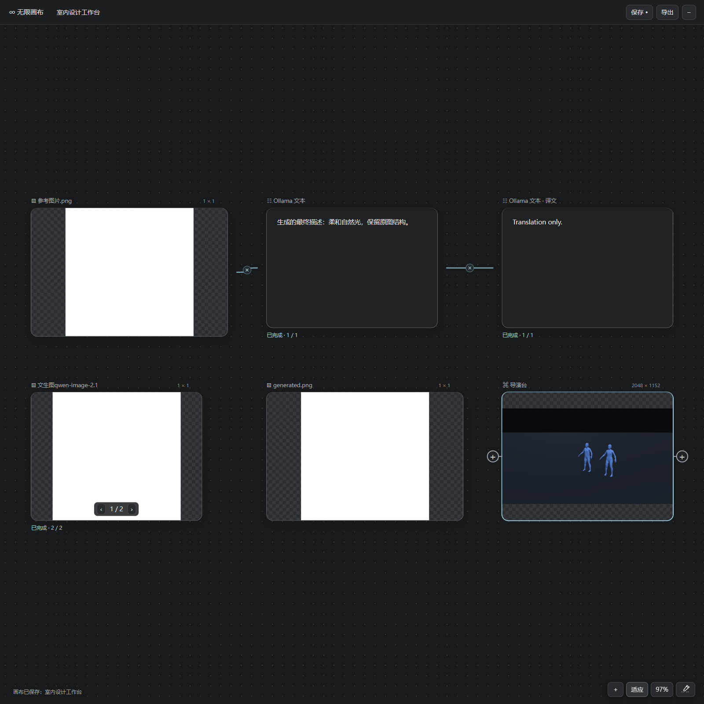
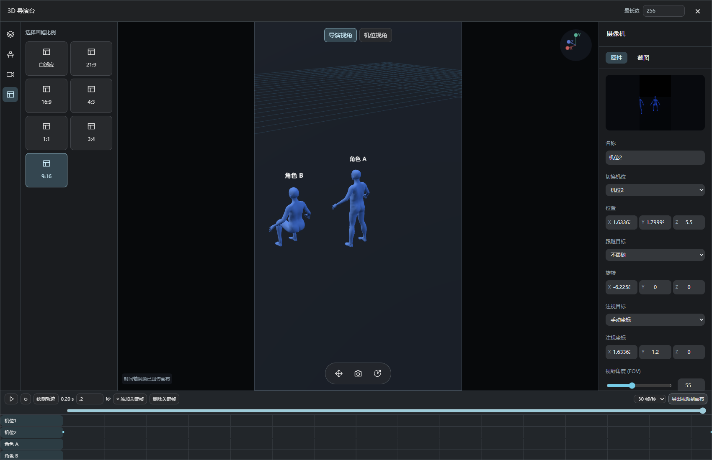

# 无限画布 · ComfyUI Infinite Canvas 1.2.0

独立的 ComfyUI 创作画布。顶部中间默认只显示「∞ 无限画布」，可拖动并记忆位置，**双击**打开全屏，初始不会运行模型、占用 3D 渲染或修改工作流。与扩图节点 ComfyUI-VisualCanvas、H3 漫剧导演台分别安装，互不替换。

1.2.0 更新：

- 文本生成结果可在节点内直接编辑、全选和删除文字；双击文本展示或提示词打开大窗口预览与编辑，右上关闭、点击外部或 Esc 关闭时保存修改。节点标题右侧 × 可删除整个节点。
- 选中文本节点后 Ctrl+A 只全选该节点的文字；输入框内维持文字全选，避免选中整个页面。
- Ctrl+Z 回退画布内容，包括添加/删除/移动节点、文字修改、素材与连接线，保留当前画布名称和视图位置。每个画布单独记录；左上菜单「设置」可修改步数上限，默认 50 步（1–500），刷新后记住上限。撤销记录仅保留在本次页面会话中，正在生成时需先停止任务。
- 连接线支持双击断开、点击中间 × 断开。底部三个按键后新增小刀按钮，C 切换小刀模式，按住左键划过多条线可批量断开，C 或 Esc 退出；一次划线操作可用一次 Ctrl+Z 整体恢复。

1.1.0 更新：

- 「无限画布」最小化入口可拖动，刷新后恢复上次位置。左上名称按 Enter 或点击外部完成并保存修改。
- 修复空白点击导致视图跳动及拖动结束后节点继续跟随鼠标的问题。中键拖动可在保留编辑器的情况下平移。
- 左上「无限画布」菜单提供回到主页、全部项目、创建新项目和删除项目；全部项目显示封面与日期，支持打开、重命名、修改封面、创建副本、移动至逻辑文件夹和删除。右上重复的「画布」按钮已移除。
- 图片、视频、文本和导演台编辑区改为贴着选中节点下方显示。缩放画布时预览节点缩放，编辑区保持原有文字与控件大小；中键平移可将下方编辑区带回视野。
- 导演台使用同源于指定 T8 / VNCCS 项目的 CC0 MakeHuman 人体资源。当前导演/机位模式高亮；拍摄使用当前模式的实际视角。默认输出最长边 2048，可选常见值或手动填写 64–8192。
- 导演台左侧图标按场景、角色、机位、画幅排列；角色属性/姿势分栏，20 个姿势预设及躯干、头、肩、肘、髋、膝调节。选中角色显示脚底方向标，右上显示世界坐标。
- 新增独立摄像机对象，机位预设会创建摄像机；可在场景列表选择，调整位置、旋转、跟随、注视目标/坐标和 FOV，并查看机位预览。W/R/S 切换移动/旋转/缩放，拖动三轴手柄编辑，Del 删除选中对象。
- 底部中间三个图标分别为变换工具、拍摄回传和时间轴。时间轴支持关键帧、插值、播放/循环、轨迹显示、时长和帧率，以及导出 WebM 到画布。视频导出按设定帧率实时录制，关闭导演台会停止导出。
- 与 **OllamaStudio 1.5.0** 联动：其浮球及浮窗可显示在全屏画布上，支持右侧停靠；开启 Z 旁的 **W**，点击画布节点会引用其图片/视频/音频/文本，再点击其他节点会替换上一节点的引用。关闭 W 清除这一路引用，手动上传与 E/Z 素材保留。

模型来源和固定版本、授权、生成步骤见 [人体资源说明](web/vendor/human/SOURCE.md)。两个插件都需更新，重启 ComfyUI 后 Ctrl+F5。

## 安装

1. 解压 `ComfyUI-InfiniteCanvas.zip`，将同名文件夹放入实际 ComfyUI 的 `custom_nodes` 目录。
2. 最终路径为 `ComfyUI/custom_nodes/ComfyUI-InfiniteCanvas/__init__.py`，避免多套一层文件夹。
3. 重启 ComfyUI，浏览器按 **Ctrl+F5**。双击顶部中间「∞ 无限画布」。

不需要额外 pip 安装。使用 ComfyUI 已有的 PyTorch、Pillow、aiohttp；导演台的 Three.js 已随插件打包，无需访问 CDN。Ollama 需自行启动并安装所需模型，插件不会下载模型。

## 画布操作

- 首页提供 **新建画布、打开历史画布、画布导入**。
- 双击空白或右键空白添加节点；上传支持选择多文件，也可将文件直接拖入画布。
- 素材、文本和生成节点均可拖动、缩放。拖动空白平移，滚轮缩放，右下角「适应」查看全部节点。
- 节点左右有连接按钮：右侧 **＋** 可添加已连接的下游节点，也可按住拖到另一节点连接；左侧 **＋** 可选择已有的上游节点。双击连线删除，循环连线会被拒绝。
- 点击文本、图片、视频节点，在右下角编辑提示词及控制参数。输入的上游文字、图片参考会出现在节点下方的编辑区。图片/视频结果可双击放大，多结果可左右切换。
- **Ctrl+S** 或顶部保存按钮保存画布。最小化保留当前页面中的内容；刷新前请保存。
- 导出会把素材文件一起写入 `.canvas.json`；导入会将这些素材上传到新服务器。画布中的工作流分组仍需在目标 ComfyUI 中存在，再重新选择对应分组。

画布信息存于 ComfyUI 当前用户目录下的 `infinite_canvas/boards`，使用 ComfyUI 的用户识别接口区分历史画布。上传的素材放在 `input/infinite_canvas/用户标识`。删除历史画布记录不会删除磁盘素材或工作流。

## Ollama 文本与翻译

添加节点 → 文本 → **Ollama 文本**。连接图片素材后，点击文本节点编辑；双击底部模型名称打开模型列表，可输入 Ollama 地址、刷新、搜索和选择模型。

模型列表读取 `/api/tags` 的磁盘大小和 `/api/show` 声明的实际能力，显示文字、图像、视频、音频标签；未声明的能力不猜测、不补写。只列本地模型。局域网使用时，地址是 **ComfyUI 服务器能够访问的 Ollama 地址**，`localhost` 指服务器电脑。

图像会缩小到最长边 1536 后传入支持图像的模型。视频参考采样最多 8 帧，按图像序列传入视觉模型，属于采样帧理解，并非原生完整视频理解。音频不做隐式识别，音频生成入口按需求预留。

运行结果显示在文本节点。点击 **译**，以当前文本结果或已填写内容作为待翻译文本，在右侧创建连接的译文节点。可选择英语、中文、日语；使用当前选择的本地 Ollama 模型，系统指令限定为只翻译、不回答和解释。可停止正在生成的文本。

## 用 ComfyUI 分组生成图片、视频与文本

插件直接读取**当前打开的工作流**中的 Ctrl+G 分组，名称用于分类：

| 分组名称示例 | 画布菜单 |
| --- | --- |
| `图片/文生图qwen-image-2.1` | 图片 → 文生图qwen-image-2.1 |
| `图片/图片编辑`、`图片/抠图` | 图片 → 对应功能 |
| `视频/图生视频` | 视频 → 图生视频 |
| `文本/提示词处理` | ComfyUI 文本 → 选择分组 |

无需额外安装 GroupRunner。执行方式与框运行类似：保留分组运行所需的上游依赖，排除无关输出分支，按次数逐次提交，等待当前任务完成后再提交下一个。必要的框外上游仍会执行。运行期间切换工作流会停止后续提交；已提交任务完成后结果仍写回原画布节点。

### 工作流辅助节点

**无限画布 · 通用文本**：放入需要控制的分组，将 STRING 输出连到提示词输入。画布编辑器的主要文本传入第一个文本输入；其他文本输入分别显示独立编辑框，可填写负面提示词等。兼容框运行的通用文本及具有 `text`、`prompt` 或多行 STRING widget 的节点。请核对编辑框名称；复杂子图内的输入绑定需在主分组中暴露。

**无限画布 · 参考图片**：放入图片编辑或图生视频分组，将 `images`、`mask` 接入相应输入。画布连接的多张参考图按连线顺序传入，尺寸不同会对齐第一张的尺寸。也支持按顺序给组内原生 `LoadImage` 的 image widget 填入文件。纯文生图无需加入参考图片节点。

**无限画布 · 分组注释**：在分组中填写使用说明。创建对应画布节点时，预览区先显示说明，例如“当前是文生图状态，上传图片不进行参考”；生成后显示实际结果。该注释不会作为提示词提交。

**无限画布 · 结果输出**：接在只有中间输出、没有保存/预览节点的分组末尾。STRING 显示为文本，IMAGE 生成 ComfyUI 原生临时预览。通常使用已有的 PreviewImage、SaveImage 或 Eagle 导出节点即可，无需另加。

画布执行会在本次提交的 prompt 中覆盖绑定参数，不改动原工作流连线；原生 seed 的 beforeQueued/afterQueued 规则继续生效。插件读取该任务终点的实际历史输出；分组只有无预览中间结果时会提示添加预览/结果输出，不会显示伪造图片。视频使用工作流已有的视频输出节点。

「风格」提供带标题的提示词预设，**双击预设**修改标题与内容，可新增并应用，随画布保存。图片编辑器不包含“画布参考”和“标记”按钮。

## 3D 导演台

从画布添加导演台节点，点击打开导演台：

- 内置 CC0 MakeHuman 人体构成的男性、女性、健硕、纤细、少年、儿童、宽厚、二头身角色，以及 3×3 群人、立方体、球体、圆柱。支持本地独立 **GLB / OBJ** 模型上传；外部贴图分离的模型请先打包成 GLB。
- 点击对象选择，右侧修改名称、位置、旋转、缩放和颜色；内置角色可调整左右臂、腿的角度。W/R/S 切换变换工具后拖动三轴手柄，Del 删除对象。
- 机位预设会在场景中创建新的摄像机，提供当前视角、正面中景、正面特写、正面全景、侧面跟拍、侧面近景、背面中景、俯拍全景、45°俯拍、低角度仰拍、低角度广角、左右过肩、鸟瞰、荷兰角。
- 可切换导演视角和机位视角，调整场景缩放/平移/旋转、天空颜色、参考全景图、全景水平旋转/球半径、地面、网格、标签、地面透明度和高度。
- 画幅支持自适应、21:9、16:9、4:3、1:1、3:4、9:16。
- 点击底部中间的**相机图标**，按当前导演/机位模式输出真实的 3D 镜头 PNG，最长边默认 2048，隐藏辅助网格与标签，可继续连接图片/视频工作流。关闭编辑器释放 WebGL 渲染资源；场景参数随画布保存。

内置角色是构图用的参数化人偶，不包含外部商业人体模型、完整骨骼 IK 或自动从自然语言搭建 3D 场景。导演台节点的文字可用 Ollama 整理场景描述；3D 构图通过导演台直接编辑。

## OllamaStudio 联动

安装 OllamaStudio 1.5.0 后，W 是独立的画布引用开关。素材准备完成前发送按钮会暂时等待，避免切换节点后误发旧引用。已发送的对话不会因切换画布节点被改写。

## 从生成历史选择

读取 ComfyUI 当前服务保留的生成历史，按图片、视频、音频分类。支持多选、上一页/下一页、15/30/60 条每页、跳页和刷新；确定后加入画布。历史中已失效或被清理的临时文件，需要重新上传或生成。多用户的画布记录独立；生成历史的可见范围沿用 ComfyUI 本身的权限。

脚本、音频作为占位节点保留；参考图中的智能剪辑、逐帧拉片不是此版本的实现范围。

## 示例与验证

将 `examples/basic-workflow.json` 拖入 ComfyUI，可看到文本分组和参考图预览分组的接法。它用于验证连接和预览，**不包含图像生成模型**；请将辅助节点接到自己的模型工作流中。

已通过：画布模型/连线/输出解析测试、后端存储校验、真实 Chrome 中的上传/模型能力/翻译/分组部分执行/结果预览/生成历史/保存恢复/3D 镜头拍摄/导出与导入测试，以及原生 ComfyUI 的 CPU 文本分组执行和保存恢复。

Ollama 测试使用本地协议服务替身，未在本次验证中运行实际大模型；图像/视频模型的推理效果、速度和第三方节点具体输出格式由对应工作流决定。大量素材时导出 JSON 体积会增大；单个上传文件上限 512 MB，普通画布信息上限 16 MB。

开发检查：`node --test tests/model.test.mjs`、`python -m unittest discover -s tests -p test_store.py`、`node tests/ui.test.cjs`。浏览器测试使用 Playwright，可用 `VC_BROWSER_PATH` 指向已安装 Chrome、`VC_PYTHON` 指向带 aiohttp 的 Python。

Third-party notices: Three.js MIT license and source record are included in `web/vendor/three/`.

新版额外验证：项目封面/复制/重命名/文件夹、入口位置恢复、无点击吸附、固定大小的贴附编辑区、人体骨骼/姿势、摄像机/FOV、视角与输出尺寸、时间轴 WebM 回传、W 新旧选择竞态与停靠。OllamaStudio 的 15 项后端回归通过；未运行实际大模型推理。
